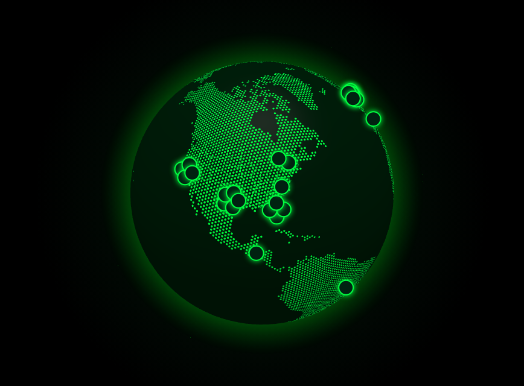

# TubeTracker

**Dante's first website:** Made with my son this site shows the top 25 kid-friendly YouTubers, their total views, who's live right now, and a 3D globe showing where they live.

## What does what (the restaurant)
| Part | Where | Restaurant job |
|---|---|---|
| HTML | `index.html` | The building: walls, rooms, signs |
| CSS | `css/style.css` | Paint and decorations (green and black!) |
| JavaScript | `js/` | The waiters. `matrix.js` makes the 1s and 0s rain, `leaderboard.js` builds the list, `globe.js` spins the Earth |
| Data | `data/creators.json` | The menu: which YouTubers are on the list and where they live. **Edit this to swap people.** |
| API | `api/` | The kitchen. It asks YouTube for views and who's live. The secret key stays in the kitchen. |
| Helpers | `lib/globe.gl` | A tool someone else built that does the hard 3D math |
| GitHub | this repo | Save game with a time machine |
| Azure | Static Web Apps | The land with a street address. Every push to `main` rebuilds the site. |

## The YouTube key
The kitchen needs a YouTube Data API key, saved in Azure (Static Web App → Settings → Environment variables) as `YOUTUBE_API_KEY`. Without it, the list still shows, just without views or LIVE badges.

## Run it on your computer
Open the folder in VS Code and use the Live Server extension. The list and globe work; views show "—" because the kitchen only runs in Azure (or with the Static Web Apps CLI: `npx @azure/static-web-apps-cli start . --api-location api`).
